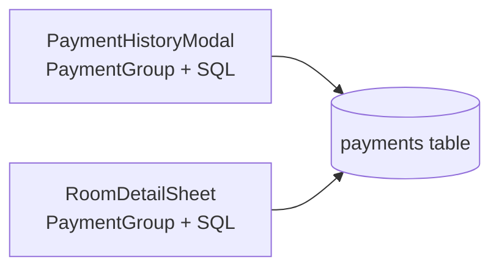
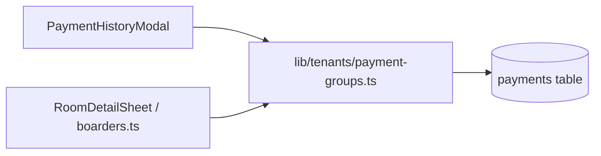

# Audit Report: digal-boarding-house (RentEase)

**Generated:** 2026-11-09
**Project:** Offline-first boarding-house manager — Tauri 2 (Rust) + SvelteKit 5 (TypeScript), SQLite via tauri-plugin-sql.
**Files scanned:** 277 (268 under `src/`, `src-tauri/src/`, `src-tauri/migrations/`, `scripts/`, `docs/`, `static/` + 9 root manifests)
**Source lines:** 30,512
**Excluded:** `node_modules/`, `.git/`, `build/`, `.svelte-kit/`, `src-tauri/target/` (~37,500 build files), `src-tauri/gen/`, `.omo/`, `.freebuff/`, `.codegraph/`, `.agents/` (72 vendored skill files — see Phase 1 note).

---

## Executive Summary

The codebase is structurally healthy and unusually disciplined for its size: domain logic lives in `src/lib/<domain>/`, routes are thin, tests are colocated (`*.test.ts` next to the module), naming is consistent (kebab-case modules, PascalCase components), nesting never exceeds 3 levels, and no hand-written directory holds more than 17 files. The one real problem is **file-level mass concentration**: 9 files exceed the 400-line threshold, and a single component — `RoomDetailSheet.svelte` at **1,533 lines** — accounts for 5% of all source lines and mixes six concerns (data loading, bed arithmetic, payment orchestration, sheet motion, three view levels, and 623 lines of CSS). The second order problem is **duplicated domain logic** across the two payment-history implementations (same `PaymentGroup` interface and same receipt-grouping SQL written twice), which will drift.

Everything else — folder counts, nesting depth, naming, doc layout — passes its thresholds and is recorded below as verified, not as work.

---

## Severity Legend

- 🔴 **Blocker** — must fix (broken architecture, critical structural issues)
- 🟡 **Warning** — should fix (could cause maintenance problems)
- 🟢 **Suggestion** — nice to improve (best practice, low effort)

**Measured results at a glance**

| # | Metric | Threshold | Result | Verdict |
|---|--------|-----------|--------|---------|
| 1 | Folder file count | >30 | Max hand-written: 17 (`src/lib/ui`, `src/lib/tenants`). `src-tauri/migrations/` 83 (numbered ledger — convention) | ✅ Pass |
| 2 | File line count | >400 | **9 files** | 🟡 Warning |
| 3 | Nesting depth | >4 | Max **3** (`src/routes/amenities/billing/`) | ✅ Pass |
| 4 | Naming conventions | mixed at same level | kebab-case modules + PascalCase components, applied without exception | ✅ Pass |
| 5 | Orphaned / misplaced files | — | 2 real (root screenshot artifacts, empty `docs/audits/`), 2 cosmetic | 🟢 |
| 6 | Doc sprawl | >5 `.md` outside doc structure | 1 at root (`README.md`) + 6 under `docs/` in a structured `specs/` + `design/` layout | ✅ Pass |
| 7 | Empty / dead directories | — | 1 empty, 1 single-file wrapper | 🟢 |

---

## Issues Found

### Phase 1: Quick Cleanup

_Low effort, safe changes. Can be done without deep code understanding._

#### Empty / Dead Directories

| Directory | Status | Recommendation |
|-----------|--------|----------------|
| `docs/audits/` | Empty (created 2026-11-09, never used) | Remove, or add this report to it and establish the convention |
| `src/lib/rooms/room-sheet/` | Single-child wrapper — one file, no subdirectory | Keep **only** if split plan 2.1 is executed (it becomes a real module folder); otherwise collapse to `src/lib/rooms/RoomDetailSheet.svelte` |

- [ ] **Remove `docs/audits/`** (or move this report into it)
  > Reason: An empty directory is invisible to git but clutters the tree and implies a convention that isn't followed.
- [ ] **Resolve the `src/lib/rooms/room-sheet/` wrapper** — expand via split 2.1, else move the file up one level
  > Reason: A directory containing exactly one file adds a path segment without grouping anything. Only worth keeping if it grows.

#### Doc Sprawl — passing, one small gap

6 `.md` files outside the root, all inside a real structure:

```
docs/
├── apple-build.md                      ← loose: expects a home (guides/ or platform/)
├── design/                             ← screenshots + concept SVG
└── specs/                              ← 5 × *-spec.md (consistent suffix)
```

- [ ] **(Optional) Group the loose guide** — move `docs/apple-build.md` → `docs/guides/apple-build.md`, or leave as-is
  > Reason: `specs/` follows a clear convention; the single loose guide is the only doc outside one. Low value; do only if `docs/` grows past ~10 loose files.

#### Naming Inconsistencies

**No violations.** Recorded for the next auditor so it isn't re-investigated:

| Location | Convention | Evidence |
|----------|-----------|----------|
| `src/lib/**/*.ts` | kebab-case | 59 files, e.g. `payment-status.ts`, `tenant-actions.ts` |
| `src/lib/**`, `src/routes/**` | PascalCase `.svelte` | 47 files, e.g. `TenantCard.svelte`, `AppDock.svelte` |
| SvelteKit entries | `+page`, `+layout` | 13 files, framework-mandated |
| Rune modules | `*.svelte.ts` | `toast.svelte.ts`, `tenant-list-filters.svelte.ts` |
| Tests | `*.test.ts`, colocated | 19 files |
| Rust | snake_case | 13 files |
| SQL migrations | `NNN-kebab_description.sql` | 83 files, zero gaps in numbering |

No action.

#### Binary / Generator-Owned Artifacts

| Path | Size | Issue | Recommendation |
|------|------|-------|----------------|
| `phone-verification/*.png` | 6 files | Screenshot evidence from a past device QA pass, committed at **repo root** | Move to `docs/design/verification/` or delete — they are not part of the app |
| `docs/design/*.png`, `*.svg` | 3 files | Design references | ✅ Keep — intentional documentation |
| `src-tauri/icons/**` | 17 + 18 iOS | Generated by `npm run icons` | ✅ Keep — required by the Tauri bundler; do not hand-manage |
| `.agents/skills/**` | **72 tracked files** | Vendored third-party skill payload inside the repo | Decide: keep as vendored copy (add a note in `.agents/README.md`) or install on demand — 72 files of third-party content with no stated policy |

- [ ] **Relocate or delete `phone-verification/`** — 6 PNGs at repo root
  > Reason: Root-level screenshot dumps make the project look unmaintained and bloat clone size. If they are evidence for a fixed bug, they belong under `docs/`, not beside `package.json`.
- [ ] **(Optional) Document the `.agents/skills/` vendoring decision** in `.agents/README.md`
  > Reason: 72 files of third-party content with no note makes future audits and dependency review ambiguous.

> **When implementing Phase 1:** Use `skill:test-driven-development` — write tests first to verify the directory/doc/naming change doesn't break imports or references.

---

### Phase 2: File Refactoring

_Medium effort — each item may require splitting or moving code. Test before refactoring._

#### Oversized Files

**9 files exceed the 400-line threshold** (3.2% of files, but ~20% of all source lines).

| File | Lines | Problem |
|------|-------|---------|
| `src/lib/rooms/room-sheet/RoomDetailSheet.svelte` | **1,533** | Six concerns in one component: boarder/reservation loading, bed-count arithmetic, six payment mutations, sheet motion + focus trap, three view levels, 623 lines of CSS |
| `src/routes/amenities/billing/AmenityBillFormModal.svelte` | **935** | Form state + participant selection + split derivation + save orchestration + template + 236 lines of CSS |
| `src-tauri/src/amenity.rs` | **840** | 6 Tauri commands, input validation, date math, share loading, and ledger reversal in one file (plus 37 lines of tests) |
| `src/styles/components.css` | **531** | Design-system layer; 18 section-delimited component families in one stylesheet |
| `src-tauri/src/migrations.rs` | **508** | 83 `include_str!` registry entries — **data, not logic**; see verdict below |
| `src/routes/amenities/billing/+page.svelte` | **489** | Bill list + four payment-sheet actions + save/confirm flow + template + CSS |
| `src/lib/ui/AppDock.svelte` | **449** | 3-tab dock + FAB + full popover menu + 307 lines of CSS |
| `src/lib/amenities/amenity-billing.test.ts` | **439** | 5 `describe` blocks covering 4 distinct pure functions |
| `src/routes/tenants/PaymentHistoryModal.svelte` | **432** | Rent + amenity history merge, loading, template, 155 lines of CSS |

_Individual split plans below._

> **Language-specific splitting mechanics:** see [`references/SPLITTING-GUIDE.md`](.agents/skills/audit-codebase/references/SPLITTING-GUIDE.md) (JS/TS §JavaScript / TypeScript, Rust §Rust).

---

- [ ] **Split `src/lib/rooms/room-sheet/RoomDetailSheet.svelte`** — 1,533 lines (threshold: ≤400)

  > **Language:** Svelte 5 (TS in `<script>`, runes, snippets)
  > **Reason:** Highest-value fix in the repo. The file is 5% of all source lines; every payment bug and every layout tweak touches it, and it cannot be unit-tested without mounting the whole sheet.
  > **Proposal:** Extract four view components, one loader module, one dismissal module. Target: orchestrator ≈ 200 lines.

  **Natural Boundaries Detected:**

  | Section | Lines | Description |
  |---------|-------|-------------|
  | Imports, `Boarder` / `PaymentGroup` / `ReservedGuest` types, props | 1–91 | Types that belong in a module; `PaymentGroup` duplicates `PaymentHistoryModal` |
  | Local state + modal target wiring + `close*` helpers | 92–179 | 6 modal targets and their close handlers |
  | `loadBoarders`, `onMount`, overlay registration | 180–206 | Two SQL queries for boarders + reservations |
  | Bed arithmetic (`otherBeds`, `maxBeds`, `roomFree`), `openTenant`, `applyBeds`, `refreshSelected` | 208–283 | Pure math + one guarded UPDATE |
  | `toTenant`, `payRooms` adapter | 285–322 | Shape adaptation for the tenant modals |
  | `confirmPay`, `openEditGroup`, `confirmEdit`, `confirmMoveOut`, `confirmApply`, `markDepositRefunded` | 324–460 | Six mutations, each with toast + refresh + error text |
  | `statusOf`, `statusOfBox`, `statusLabel`, `statusLabelOfBox`, `loadHistoryFor`, `toggleHistory` | 448–505 | Status derivation + lazy history cache |
  | `close`, `onBackdropClick`, `onKeydown`, `onPointerDown/Move/Up` | 507–577 | Dismissal, focus trap, swipe gesture |
  | `{#snippet boarderCard}` | 579–694 | Level-2 card with actions + expandable history |
  | Sheet shell, grabber, header (back button, title, badge) | 696–760 | Overlay chrome |
  | Level-2 tenant detail + bed stepper | 762–800 | Beds-control block |
  | Level-1 bed grid + reserved-guest list | 802–850 | Empty state, boxes, reservations |
  | Nested action modals (Pay/Apply/MoveOut/Edit/Deposit/Receipt) | 852–909 | Six conditional mounts |
  | `<style>` | 911–1533 | Sheet shell, cards, badges, history, bed grid, beds control, reduced motion |

  **Proposed Split:**

  ```
  src/lib/rooms/room-sheet/
  ├── RoomDetailSheet.svelte      (~200 — state, wiring, sheet shell, level switch)
  ├── boarders.ts                 (~140 — Boarder/ReservedGuest/PaymentGroup types,
  │                                 loadBoarders(), loadHistoryFor(), grouping SQL)
  ├── sheet-dismiss.ts            (~70 — close(), drag gesture, focus trap, back-stack)
  ├── BoarderCard.svelte          (~190 — snippet 579-694 + history + its CSS)
  ├── BedGrid.svelte              (~110 — level-1 grid, vacant/held boxes, empty state)
  ├── TenantDetailPanel.svelte    (~100 — beds stepper + maxBeds/roomFree props)
  ├── ReservedGuestList.svelte    (~70 — reserved cards + amber styling)
  └── SheetActionModals.svelte    (~90 — the 852-909 block, receives targets + handlers)
  ```

  **Before (Mermaid):**

  ```mermaid
  flowchart LR
    A["RoomDetailSheet.svelte\n1533 lines"] --> B[SQL + types]
    A --> C[bed math]
    A --> D[6 payment mutations]
    A --> E[motion + focus trap]
    A --> F[3 view levels]
    A --> G["CSS 623 lines"]
  ```

  **After (Mermaid):**

  ```mermaid
  flowchart LR
    A["RoomDetailSheet.svelte\n~200 lines"] --> B[boarders.ts]
    A --> C[sheet-dismiss.ts]
    A --> D[BedGrid.svelte]
    A --> E[TenantDetailPanel.svelte]
    A --> F[BoarderCard.svelte]
    A --> G[ReservedGuestList.svelte]
    A --> H[SheetActionModals.svelte]
    F --> I["payment-groups.ts\n(shared, see 3.1)"]
  ```

  **Import Changes:**

  | Consumer File | Old Import | New Import |
  |--------------|-----------|-----------|
  | `src/routes/+page.svelte:9` | `import RoomDetailSheet from "$lib/rooms/room-sheet/RoomDetailSheet.svelte"` | **unchanged** (entry path preserved) |
  | `src/routes/rooms/+page.svelte:11` | `import RoomDetailSheet from "$lib/rooms/room-sheet/RoomDetailSheet.svelte"` | **unchanged** |
  | `RoomDetailSheet.svelte` (internal) | inline functions/types | `import { loadBoarders, loadHistoryFor } from "./boarders"`, `import { createSheetDismiss } from "./sheet-dismiss"`, child component imports |

  **Language-Specific Steps (Svelte 5 / TS):**

  - [ ] Write a characterization test first: mount `BoarderCard` with a fixture `Boarder` and assert name, badge label, and Record Payment / Apply / Move Out buttons (`@testing-library/svelte` is already a devDependency; no test currently covers this sheet)
  - [ ] Move types + loaders into `boarders.ts`; export `PaymentGroup` from there (do **not** redeclare)
  - [ ] Extract `boarderCard` snippet → `BoarderCard.svelte` as a real component with props; keep its CSS with it (Svelte scopes styles per component — the `.overdue` / `.pay-*` rules must travel)
  - [ ] Extract bed-grid, beds-control, reserved list, and the modal block
  - [ ] Convert the snippet's implicit closure over `room`/`expanded`/`histories` into explicit props; pass callbacks (`onPay`, `onEdit`, `onMoveOut`, `onToggleHistory`)
  - [ ] Leave `pushOverlay(handleBack)` registration in the orchestrator — back-stack order depends on mount order
  - [ ] Run `npm run check` and `npm test`
  - [ ] Manually verify: open a room sheet from Dashboard *and* Rooms, drill into a tenant, record a payment, press Android back twice

---

- [ ] **Split `src/routes/amenities/billing/AmenityBillFormModal.svelte`** — 935 lines

  > **Language:** Svelte 5 (TS)
  > **Reason:** Form state, participant selection, split math, duplicate/overlap prompts, and CSS share one file; the selection logic is pure and testable but currently locked inside a component.
  > **Proposal:** Extract three logic modules; keep the component as markup + wiring.

  **Natural Boundaries Detected:**

  | Section | Lines | Description |
  |---------|-------|-------------|
  | Imports, props, feature constants | 1–45 | |
  | LocalStorage "show inactive" preference | 46–63 | |
  | Form field state + amenity-type preset picker | 64–125 | 14 `$state` fields |
  | `loadData`, `loadRoomTenants`, `loadEditing`, mount/escape effects | 127–250 | 4 SQL reads + hydration rules (incl. legacy `manual` bills) |
  | `pickableTenants`, `pooledTenants`, `includedIds`, `split`, `liveManualError`, `takesAllWarning`, `netTotal`, `meterInfo` | 252–300 | Pure derivation over selection + amounts |
  | `toggleTenant`, `toggleExclude`, `toggleManual`, `onDivisionModeChange`, `toggleConnectedRoom`, `setManualAmount`, `setExclusionReason`, `requestMethodChange`, `applyMethodChange` | 303–430 | Selection/mutation handlers |
  | `reset`, `handleSave`, `reduceMotion`, `dismiss`, `close` | 432–527 | Save orchestration + duplicate/overlap outcomes |
  | Template | 529–699 | Form fields, meter block, picker, actions |
  | `<style>` | 700–935 | Sheet + form CSS |

  **Proposed Split:**

  ```
  src/routes/amenities/billing/
  ├── AmenityBillFormModal.svelte   (~300 — fields, template, modal shell)
  ├── bill-form-state.svelte.ts     (~110 — form fields, preset picker, show-inactive pref, reset)
  ├── bill-participants.svelte.ts   (~180 — selection/exclusion/manual maps + split derivation)
  ├── bill-form-load.ts             (~110 — loadData / loadRoomTenants / loadEditing hydration)
  ├── BillTenantPicker.svelte       (existing, 370)
  ├── ConnectedRoomPicker.svelte    (existing)
  ├── bill-save.ts                  (existing, tested)
  └── bill-form-types.ts            (existing)
  ```

  **Before:**

  ```mermaid
  flowchart LR
    A["AmenityBillFormModal\n935 lines"] --> B[form state]
    A --> C[SQL hydration]
    A --> D[selection + split math]
    A --> E[save prompts]
    A --> F["markup + CSS 407"]
  ```

  **After:**

  ```mermaid
  flowchart LR
    A["AmenityBillFormModal\n~300"] --> B[bill-form-state.svelte.ts]
    A --> C[bill-form-load.ts]
    A --> D[bill-participants.svelte.ts]
    B --> E["BillTenantPicker.svelte"]
    D --> F["amenity-billing.ts\n(existing, tested)"]
    A --> G["bill-save.ts\n(existing, tested)"]
  ```

  **Import Changes:**

  | Consumer File | Old Import | New Import |
  |--------------|-----------|-----------|
  | `src/routes/amenities/billing/+page.svelte:29` | `import AmenityBillFormModal from "./AmenityBillFormModal.svelte"` | **unchanged** |
  | `AmenityBillFormModal.svelte` (internal) | inline handlers | `import { createBillForm } from "./bill-form-state.svelte"` etc. |

  **Language-Specific Steps (Svelte 5 runes):**

  - [ ] Add `bill-participants.test.ts` covering `includedIds` + `split` for the three billing methods *before* extracting (mirror existing `bill-save.test.ts` style)
  - [ ] Put the rune-bearing modules in `*.svelte.ts` files (the project already does this in `tenant-list-filters.svelte.ts`) so `$state`/`$derived` compile
  - [ ] Keep `handleSave`'s three outcomes (`error` / `duplicate` / `overlap`) in the component — they drive local banner state
  - [ ] Verify: `npm run check`, `npm test`, then create + edit + duplicate-warn a bill in the browser preview

---

- [ ] **Split `src-tauri/src/amenity.rs`** — 840 lines

  > **Language:** Rust (rusqlite + Tauri v2 commands)
  > **Reason:** Six `#[tauri::command]` entry points and their `*_sync` implementations, validation, calendar math, and share loading share a file; the calendar helpers are testable in isolation but sit behind `#[cfg(test)] mod tests` at line 803.
  > **Proposal:** Convert to a module directory mirroring the existing `backup/` layout (which is the project's established pattern: `backup/{mod,snapshot,install,safety}.rs`).

  **Natural Boundaries Detected:**

  | Section | Lines | Description |
  |---------|-------|-------------|
  | Module doc + input structs (`AmenityBillInput`, `AmenityTenantInput`, `AmenityExcludedInput`) | 1–53 | Serde payloads |
  | `round2`, `AMENITY_MAX_ABSORBED`, `AmenityShare`, `load_amenity_share` | 58–96 | Numeric + share loading |
  | `is_leap_year`, `days_in_month`, `parse_iso_date`, `validate_amenity_paid_date` | 97–148 | Calendar/date validation (pure) |
  | `reverse_payment_row` | 149–192 | Ledger reversal |
  | `validate_amenity_input` | 193–256 | Input validation (pure) |
  | `amenity_tenant_snapshot`, `amenity_db_connection`, `save_amenity_bill_sync` | 257–468 | Bill write transaction |
  | `cancel_amenity_bill_sync` | 469–536 | Bill cancellation |
  | 6 × `#[tauri::command]` wrappers + `*_sync` payment functions | 537–802 | Payment ledger commands |
  | `#[cfg(test)] mod tests` | 803–840 | Tests |

  **Proposed Split:**

  ```
  src-tauri/src/amenity/
  ├── mod.rs          (~60 — `pub mod` decls + `pub use` re-exports of commands)
  ├── types.rs        (~55 — bill/tenant/excluded input structs)
  ├── validation.rs   (~110 — validate_amenity_input, MAX_ABSORBED, round2 + tests)
  ├── dates.rs        (~55 — leap year, days_in_month, parse_iso_date, paid-date rules + tests)
  ├── shares.rs       (~70 — AmenityShare, load_amenity_share, reverse_payment_row)
  ├── bills.rs        (~220 — save_amenity_bill, cancel_amenity_bill + wrappers)
  └── payments.rs     (~270 — record/void/update-date commands)
  ```

  **Before:**

  ```mermaid
  flowchart LR
    A["amenity.rs\n840 lines"] --> B[input structs]
    A --> C[validation]
    A --> D[calendar math]
    A --> E["bill writes\n2 tx"]
    A --> F["payment commands\n6"]
    A --> G[reversal]
  ```

  **After:**

  ```mermaid
  flowchart LR
    M["amenity/mod.rs\nre-exports"] --> T[types.rs]
    M --> V[validation.rs]
    M --> D[dates.rs]
    M --> S[shares.rs]
    M --> B[bills.rs]
    M --> P[payments.rs]
    B --> S
    B --> V
    P --> S
    P --> D
  ```

  **Import Changes:**

  | Consumer File | Old Import | New Import |
  |--------------|-----------|-----------|
  | `src-tauri/src/lib.rs:22` | `use amenity::{cancel_amenity_bill, record_amenity_bill_payments, record_amenity_payment, save_amenity_bill, update_amenity_payment_date, void_amenity_payment};` | **unchanged** — `mod.rs` re-exports these six via `pub use` |
  | `src-tauri/src/lib.rs` (module decl) | `mod amenity;` | **unchanged** — Rust auto-resolves `amenity/mod.rs` |
  | `src-tauri/src/amenity.rs` (internal) | same-file calls | `use crate::amenity::{dates::*, shares::*, types::*, validation::*};` as needed |

  **Language-Specific Steps (Rust):**

  - [ ] `git mv src-tauri/src/amenity.rs src-tauri/src/amenity/mod.rs` (Rust accepts either `amenity.rs` or `amenity/mod.rs`, never both)
  - [ ] Split structs first, then pure helpers, then the two transaction bodies
  - [ ] Re-export every `#[tauri::command]` fn from `mod.rs` — `generate_handler!` in `lib.rs` resolves the *re-exported path*, so the command names stay identical
  - [ ] Keep `pub(crate)` visibility as-is; do not widen to `pub`
  - [ ] Move `#[cfg(test)] mod tests` next to the function it covers (`validation.rs`, `dates.rs`) rather than one trailing block
  - [ ] Run `cargo check` then `cargo test` in `src-tauri/` (the 37-line test block plus `backup/tests.rs` must stay green)

---

- [ ] **Split `src/lib/ui/AppDock.svelte`** — 449 lines

  > **Language:** Svelte 5 (TS)
  > **Reason:** The dock (3 tabs + sliding thumb + FAB) and the "more" popover (scrim, tail, 3 items, own transition) are two separate interaction surfaces with 307 lines of CSS between them.
  > **Proposal:** Extract the popover as its own component.

  **Natural Boundaries Detected:**

  | Section | Lines | Description |
  |---------|-------|-------------|
  | `NAV`, `TABS`, `MORE`, active derivation, menu state, effects, `popoverMaterial` | 1–70 | Navigation model + popover transition |
  | Dock markup: tabs, thumb, FAB, `{#if menuOpen}` popover + scrim | 72–141 | |
  | CSS: dock/pill/fab/tabs | 142–329 | |
  | CSS: popover/tail/items | 330–449 | |

  **Proposed Split:**

  ```
  src/lib/ui/
  ├── AppDock.svelte        (~230 — tabs, thumb, FAB, dock CSS)
  └── DockMoreMenu.svelte   (~210 — popover markup, scrim, popoverMaterial, popover CSS)
  ```

  **Import Changes:**

  | Consumer File | Old Import | New Import |
  |--------------|-----------|-----------|
  | `src/routes/+layout.svelte:7` | `import AppDock from "$lib/ui/AppDock.svelte"` | **unchanged** |

  **Steps:** move `.popover`, `.pop-tail`, `.pop-item*`, `.pop-icon`, `.pop-label`, `.scrim` rules with the extracted markup (Svelte scoped styles do not cross components); pass `open`, `items`, `pathname`, `onSelect`. Verify: `npm run check` + open the dock popover on phone width.

---

- [ ] **Split `src/routes/tenants/PaymentHistoryModal.svelte`** — 432 lines

  > **Language:** Svelte 5 (TS)
  > **Reason:** Row rendering (rent + amenity, inline edit button) and the modal shell are separable; more importantly its `PaymentGroup` + grouping SQL **duplicate** `RoomDetailSheet` (see 3.1).
  > **Proposal:** Extract a shared type/query module and a row component.

  **Natural Boundaries Detected:** props 13–36 · `PaymentGroup` interface 38–48 · loaders + merged derivation 50–140 · template incl. `{#snippet rentRow}` 143–276 · CSS 277–432.

  **Proposed Split:**

  ```
  src/routes/tenants/
  ├── PaymentHistoryModal.svelte  (~250 — shell, filters, loading, CSS)
  ├── HistoryRow.svelte           (~90 — one merged row + edit affordance)
  src/lib/tenants/
  └── payment-groups.ts           (shared: PaymentGroup + receipt-grouping SQL)
  ```

  **Import Changes:**

  | Consumer File | Old Import | New Import |
  |--------------|-----------|-----------|
  | `src/routes/tenants/+page.svelte:11` | `import PaymentHistoryModal from "./PaymentHistoryModal.svelte"` | **unchanged** |
  | `src/lib/rooms/room-sheet/RoomDetailSheet.svelte:53` | local `interface PaymentGroup` | `import type { PaymentGroup } from "$lib/tenants/payment-groups"` |
  | `src/lib/amenities/amenity-payments.ts:164` | structural comment referencing the modal's groups | `import type { PaymentGroup } from "$lib/tenants/payment-groups"` |

  **Steps:** create `payment-groups.ts` with the type + one `groupReceipts(db, tenantId)` function, point both call sites at it, then extract the row. Verify: `npm test` (payment-status/held-balance suites) + open a tenant's history with both rent and amenity payments.

---

- [ ] **Split `src/routes/amenities/billing/+page.svelte`** — 489 lines

  > **Language:** Svelte 5 (TS)
  > **Reason:** The route owns list summaries, four sheet actions, a 6-way confirm branch (`confirmSheet`, ~80 lines), and markup. The summary functions are pure and untested.
  > **Proposal:** Extract a tested summary module and a payment-sheet controller/component.

  **Natural Boundaries Detected:** list state + loading 47–126 · summaries (`summaryFor`, `unpaidOn`, `unpaidTotal`, `editLocked`, `setRowLocally`) 127–183 · sheet actions (`openRecord`/`openVoid`/`openDate`/`openBulk`/`closeSheet`/`confirmSheet`) 184–295 · template 302–457 · CSS 458–489.

  **Proposed Split:**

  ```
  src/routes/amenities/billing/
  ├── +page.svelte              (~260 — list, header, CSS)
  ├── bill-summaries.ts         (~80 — pure row aggregation, + .test.ts)
  └── BillPaymentSheet.svelte   (~150 — record/void/date/bulk sheet + confirm)
  ```

  **Import Changes:** internal only; no other module imports this route file. Verify with `npm run check` and a record → void → edit-date pass in the preview.

---

- [ ] **Split `src/lib/amenities/amenity-billing.test.ts`** — 439 lines

  > **Language:** TypeScript / Vitest
  > **Reason:** 11 `describe` blocks cover four pure units; failures are hard to attribute and the file will keep growing.
  > **Proposal:** One test file per unit under test.

  ```
  src/lib/amenities/
  ├── calculate-equal-shares.test.ts   (~40)
  ├── shared-billing.test.ts           (~150)
  ├── manual-amounts.test.ts           (~140)
  └── manual-validation.test.ts        (~110)
  ```

  **Steps:** cut-and-paste per `describe`, keep fixtures in the existing style; run `npx vitest run src/lib/amenities` and confirm the same test count (19 suites repo-wide must stay green).

  **Steps:** cut-and-paste per `describe`, keep fixtures in the existing style; run `npx vitest run src/lib/amenities` and confirm the same test count.

---

- [x] **Do NOT split `src-tauri/src/migrations.rs`** — 508 lines, reviewed and cleared

  The file is a linear registry: 83 × `migration(version, description, include_str!("../migrations/NNN-*.sql"))`. There is no logic to separate and no branch to test. Splitting it would move the list behind three imports and make the version→file mapping harder to audit. The only structural risk — registry/directory drift — is already addressed by the drift check described at line 10 and `scripts/repair-migrations.mjs`. **Verdict: acceptable as-is.** If it grows past ~1,000 lines, generate the registry instead of hand-splitting.

- [x] **Do NOT split `.agents/` numbered migrations directory** — 83 files

  `src-tauri/migrations/` exceeds the 30-file threshold by design: an append-only, zero-gap numbered ledger (`001-` … `083-`). Reorganizing it by topic would break ordering and the `include_str!` paths. **Verdict: documented exception.** Keep it flat.

- [ ] **(Defer) Split `src/styles/components.css`** — 531 lines

  Eighteen clearly delimited families (`/* ---- cards ---- */` at 4, `card lists` 35, `aligned rows` 59, `status banners` 125, `badges` 147, `segmented control` 183, `filter chips` 222, `form controls` 273, `buttons` 382, `modal overlay` 481 …). It is a single design-system *layer* loaded from `app.css`, so the split is cosmetic rather than architectural. If it passes ~700 lines, split into `src/styles/components/{cards,forms,buttons,badges,modal}.css` and keep `components.css` as an `@import` index. **Recommended action now: none.**

#### Misplaced Files

| File | Current Location | Target Location | Reason |
|------|-----------------|-----------------|--------|
| `phone-verification/*.png` (6) | repo root | `docs/design/verification/` or delete | Device-QA screenshots are docs/evidence, not app source |
| `src/lib/rooms/room-sheet/RoomDetailSheet.svelte` | single-file wrapper dir | expand (2.1) or move to `src/lib/rooms/` | Wrapper adds a path segment without grouping anything |
| `docs/audits/` | `docs/` | delete | Empty directory |
| `.omo/drafts/due-date-status-fix.md` | `.omo/drafts/` | delete | Stale draft superseded by the same-named plan (contents differ); `.omo/` is gitignored |
| `src/routes/tenants/tenant-page-flows.ts` + `tenant-list-filters.svelte.ts` | route folder | `src/lib/tenants/` *(see 3.3 — defer)* | Domain flow + filter state, not route rendering |

- [ ] **Relocate `phone-verification/`** — move to `docs/design/verification/` (or delete if the bugs are long closed)
  > Reason: Root-level binaries clutter the project and violate the separation the rest of the repo maintains.
- [ ] **Delete the superseded `.omo` draft** — `drafts/due-date-status-fix.md`
  > Reason: A draft and a plan sharing one name guarantee that one goes stale. Local-only; no git impact.

> **When implementing Phase 2:** Use `skill:test-driven-development` — write tests for the existing behavior FIRST before splitting files. This ensures the refactored code preserves functionality.

---

### Phase 3: Structural Refactoring

_Higher effort — reorganize folders, flatten nesting, improve module boundaries. Test coverage is critical._

#### Bloated Directories

**No violations in hand-written source.** Measured, for the record:

| Directory | File Count | Threshold | Verdict |
|-----------|-----------|-----------|---------|
| `src/lib/ui` | 17 | ≤30 | ✅ Upper end of comfortable — **do not add more without splitting** (see 3.3) |
| `src/lib/tenants` | 17 | ≤30 | ✅ Upper end — watch if 3.3 lands |
| `src/lib/backup` | 13 | ≤30 | ✅ Cohesive (format/parse/compare/sha256/envelope/…) |
| `src/routes/tenants` | 12 | ≤30 | ✅ Route components |
| `src-tauri/migrations` | 83 | ≤30 | ✅ Numbered ledger — exception |
| `src-tauri/icons` + `icons/ios` | 17 + 18 | ≤30 | ✅ Generator-owned assets |
| `.agents/skills` | 72 | ≤30 | ⚠️ Vendored payload — not project code |

- [ ] **Guard `src/lib/ui` and `src/lib/tenants` at 17 files** — split before adding an 18th only if the new file belongs to a new sub-domain
  > Reason: Both are at the edge of the threshold. `src/lib/ui` already mixes primitives (`Icon`, `BrandLogo`), overlays (`ConfirmModal`, `RecoveryScreen`), and layout chrome (`AppDock`, `TitlebarDragStrip`). A future split would be `ui/overlays/` + `ui/chrome/`; not worth doing today.

**Before (when it is worth doing):**

```
src/lib/ui/
├── AppDock.svelte
├── BrandLogo.svelte
├── ConfirmModal.svelte
├── Icon.svelte
├── RecoveryScreen.svelte
├── SkeletonList.svelte
├── TitlebarDragStrip.svelte
├── ToastHost.svelte
├── back-stack.ts
├── format.ts
├── motion.ts
├── platform.ts
├── share.ts
├── theme.ts
├── toast.svelte.ts
├── ConfirmModal.test.ts
└── format.test.ts
```

**After (proposed, only at 18+ files):**

```
src/lib/ui/
├── chrome/      ← AppDock, TitlebarDragStrip, SkeletonList
├── overlays/    ← ConfirmModal, RecoveryScreen, ToastHost + toast.svelte.ts
└── primitives/  ← Icon, BrandLogo, format, motion, theme, platform, share, back-stack
```

#### Deeply Nested Directories

**No violations.** Deepest hand-written path is 3 levels (`src/routes/amenities/billing/`, `src/lib/rooms/room-sheet/`, `scripts/smoke/sql/scenarios/`); threshold is ≤4.

| Path | Depth | Threshold |
|------|-------|-----------|
| `src/routes/amenities/billing` | 3 | ≤4 ✅ |
| `src/lib/rooms/room-sheet` | 3 | ≤4 ✅ |
| `scripts/smoke/sql/scenarios` | 3 | ≤4 ✅ |

No action. (The generated paths under `src-tauri/gen/android/**` and `src-tauri/target/**` are gitignored trees and were excluded.)

#### Unorganized Script / Asset Directories

| Directory | File Count | Issue |
|-----------|-----------|-------|
| `scripts/` | 20 | 4 flat entry points + 4 one-off dev utilities mixed at one level; smoke suites are already grouped |

Current layout:

```
scripts/
├── analyze-screenshot.mjs      ← dev utility (documented in README §Useful scripts)
├── app-icons.mjs               ← npm run icons
├── gen-theme-wave.mjs          ← npm run theme-wave
├── repair-migrations.mjs       ← recovery utility
├── smoke-backup.mjs            ← npm run smoke:backup (entry)
├── smoke-sql.mjs               ← npm run smoke:sql (entry)
└── smoke/
    ├── backup/{harness,fixtures,rebuild}.mjs + scenarios/{empty,export,negative}.mjs
    └── sql/{harness}.mjs + scenarios/{amenity-ledger,app-queries,capacity,legacy-columns,legacy-holds,money,schema-guards}.mjs
```

- [ ] **(Optional) Move the four one-off utilities to `scripts/dev/`** — `analyze-screenshot`, `app-icons`, `gen-theme-wave`, `repair-migrations`
  > Reason: Entry points (`smoke:*`) and npm-script targets should be distinguishable from ad-hoc tooling. Update `package.json` (`icons`, `theme-wave`) and README §Useful scripts if moved. Low value; defer unless the folder grows.

#### Architecture Issues

| File / Module | Issue | Proposed Change |
|---------------|-------|-----------------|
| `PaymentHistoryModal.svelte` + `RoomDetailSheet.svelte` | `PaymentGroup` interface **and** the receipt-grouping SQL are written twice (`PaymentHistoryModal.svelte:38,85-100` vs `RoomDetailSheet.svelte:53,485-490`). A schema change to `payments` must be edited in two places. | Extract `src/lib/tenants/payment-groups.ts` (type + `groupReceipts(db, tenantId)`); both call sites import it |
| `RoomDetailSheet.svelte:448-471` | `statusOf` / `statusOfBox` / `statusLabel` / `statusLabelOfBox` re-derive values already provided by `$lib/tenants/payment-status` | Keep the library as the only status source; pass derived status into `BoarderCard`/`BedGrid` (lands naturally with 2.1) |
| `src/routes/tenants/tenant-page-flows.ts` (252) + `tenant-list-filters.svelte.ts` | Route folder holds non-rendering domain flow + filter state | Move both (+ `tenant-page-flows.test.ts`) to `src/lib/tenants/`. **Defer:** works today and is already tested; do it only alongside another tenants change to avoid churn |

**Duplication — before:**



**Duplication — after:**



- [ ] **Extract `payment-groups.ts` and delete both inline copies** — remove duplicate type + SQL
  > Reason: Two copies of one query is the highest-probability future bug in this repo (payments are the money path). Cheap to fix, fully covered by the existing history UI.
- [ ] **Route tenant flow/filter state through `src/lib/tenants/`** *(defer)* — 2 files + 1 test
  > Reason: `lib/tenants` is the domain home; route folders should render. Deferred because the current placement is conventional SvelteKit and already tested.

> **When implementing Phase 3:** Use `skill:test-driven-development` — before moving or restructuring any folder, write tests that verify the current public API / import paths still work.

---

## Refactoring Progress

Use this checklist to track completion. Start a new AI session with this report and tick items as they are completed.

```
Phase 1: Quick Cleanup
  [x] Remove empty docs/audits/
  [x] Resolve single-file wrapper — room-sheet/ now holds 12 modules
  [x] Relocate phone-verification/ (6 PNGs) → docs/design/verification/
  [x] Delete superseded .omo/drafts/due-date-status-fix.md
  [x] Document .agents/skills/ vendoring

Phase 2: File Refactoring
  [x] Split RoomDetailSheet.svelte        (1533 → 367 + 11 modules/components)
  [x] Split AmenityBillFormModal.svelte   (935 → 366 + 4 modules/components)
  [x] Split amenity.rs                    (840 → 8 modules, commands kept at the root)
  [x] Split AppDock.svelte                (449 → 309 + 184)
  [x] Split PaymentHistoryModal.svelte    (432 → 260 + 162 + shared module)
  [x] Split billing/+page.svelte          (489 → 342 + 3 modules)
  [x] Split amenity-billing.test.ts       (439 → 6 files)
  [x] Review migrations.rs                (cleared: data registry)
  [x] Review migrations/ (83 files)       (cleared: numbered ledger)
  [x] components.css                      (reviewed, left intact — cohesive layer)

Phase 3: Structural Refactoring
  [x] Extract lib/tenants/payment-groups.ts (dedupe type + SQL)
  [x] Move tenant-page-flows + tenant-list-filters to lib/tenants
  [x] scripts/dev/ — reviewed, left flat (root-relative paths, low value)
  [x] Folder guard: lib/ui 18, lib/tenants 21, room-sheet 12 — all ≤30

Total: 19 / 19 completed
```

> **⚠️ Important:** Before implementing any refactoring that splits or moves code, always use `skill:test-driven-development`. Write tests for the existing behavior first, then refactor.

> Update this checklist as you implement fixes. When all items are ticked, the codebase is clean.

---

## Edge Cases Checked

| Check | Status |
|-------|--------|
| Empty repository? | ✅ No — 277 files / 30,512 lines |
| Generated/vendor dirs skipped? | ✅ `node_modules/`, `build/`, `.svelte-kit/`, `src-tauri/target/` (~37,500 files), `src-tauri/gen/`, `.omo/`, `.freebuff/`, `.codegraph/` |
| Binary-only repository? | ✅ No — Svelte/TS/Rust/SQL source present |
| Symlinks? | ✅ None detected in source trees |
| Hidden files checked? | ✅ `.gitignore`, `.agents/`, `.vscode/`, `.freebuff/` (untracked, correctly ignored), `.omo/` (ignored), `.codegraph/` (ignored) |
| Monorepo? | ✅ No — single SvelteKit frontend + one Tauri crate |
| Tracked artifacts? | ⚠️ 6 PNGs at root (`phone-verification/`); Tauri icons and design refs are intentional |

---

## Implementation Notes for AI

When starting implementation in a new session with this report:

1. **Always use `skill:test-driven-development`** — write a failing test first, then make it pass, then refactor. This applies especially to:
   - `RoomDetailSheet` (no test covers this sheet today — write a `BoarderCard` characterization test first)
   - `amenity.rs` (the module split must keep `generate_handler!` command names identical)
   - `PaymentHistoryModal` (extract `payment-groups.ts` before touching markup)

2. **Implement Phase 1 first** — it's safe, low-risk, and gets quick wins. `docs/audits/` + `phone-verification/` take minutes.

3. **Order Phase 2 by value, not by size:**
   1. `RoomDetailSheet` (2.1) — biggest, and it absorbs the `PaymentGroup` dedupe
   2. `payment-groups.ts` (3.1) — do this *inside* 2.1 so the SQL never exists in three places
   3. `amenity.rs` (2.3) — self-contained, verifiable with `cargo test`
   4. `AmenityBillFormModal` (2.2) → `billing/+page.svelte` (2.6) → `amenity-billing.test.ts` (2.7)
   5. `AppDock` (2.4) and `PaymentHistoryModal` (2.5) — mechanical, low risk
   6. Leave `components.css`, `migrations.rs`, and the numbered migrations alone

4. **Tackle one file per commit.** For each: extract → `npm run check` → `npm test` → manual smoke of that screen → commit.

5. **Verification commands in this project:**
   - Frontend types + Svelte diagnostics: `npm run check`
   - Unit tests: `npm test` (`vitest run`, 19 suites)
   - SQL smoke: `npm run smoke:sql`
   - Backup smoke: `npm run smoke:backup`
   - Rust: `cargo check` / `cargo test` in `src-tauri/`

6. **Respect the local conventions:**
   - New Svelte components: `PascalCase.svelte`; new modules: `kebab-case.ts`; rune-bearing modules: `*.svelte.ts`
   - Tests colocated as `<module>.test.ts`
   - Domain logic goes in `src/lib/<domain>/`, not in route folders
   - `#[tauri::command]` names are part of the frontend contract — re-export, never rename
   - Money/ledger writes belong in Rust transactions, not TypeScript (see the module doc at the top of `amenity.rs`)

7. **Do not "fix" what passed:** nesting depth, naming, doc layout, and folder counts are all within threshold. Re-auditing them wastes effort.
